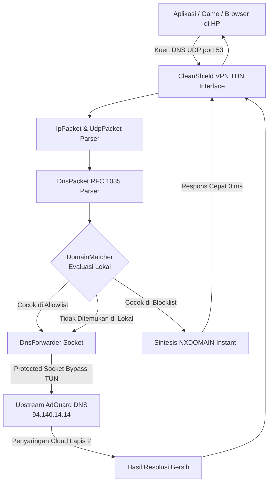

# 🛡️ CleanShield — Local DNS Ad & Tracker Blocker

[-brightgreen.svg)](https://developer.android.com)
[](https://kotlinlang.org)
[](https://developer.android.com/jetpack/compose)
[-cyan.svg)](#-liquid-glass-design-system)
[](#-arsitektur-dual-layer-shield)
[](LICENSE)

**CleanShield** adalah aplikasi pemblokir iklan (*Ad Blocker*) dan pelacak privasi (*Tracker Blocker*) lokal untuk Android berbasis **VpnService** tanpa memerlukan akses root. Menggunakan pendekatan **Dual-Layer Shield** berkecepatan tinggi (0 ms latency di perangkat), CleanShield menyaring permintaan DNS langsung di ponsel Anda sebelum iklan sempat diunduh, menghemat kuota data, menjaga daya tahan baterai, dan melindungi privasi.

Aplikasi ini dikemas dengan antarmuka futuristik bertema **Liquid Glass (Glassmorphism & Fluid Cyber)** yang modern, elegan, dan dinamis.

---

## 🌟 Fitur Utama

### 1. 🛡️ Dual-Layer Shield Protection
CleanShield menggabungkan kekuatan pemblokiran lokal dan kecerdasan cloud:
* **Lapis 1 (Lokal - 0 ms Latency):** Filter instan di memori HP menggunakan puluhan ribu aturan domain. Begitu aplikasi memanggil server iklan, CleanShield langsung menjawab `NXDOMAIN` (*Server Not Found*) tanpa membuang kuota internet.
* **Lapis 2 (Upstream Cloud Filter):** Query legal di-forward ke **AdGuard DNS** (`94.140.14.14`) sebagai jaring pengaman lapis kedua untuk mencegat domain iklan baru yang belum terdaftar di database lokal.

### 2. 🚫 Anti-Bypass Hardcoded DNS
Banyak SDK iklan modern (seperti Google AdMob atau Unity Ads) sengaja menghindari DNS lokal ponsel dengan langsung mengirim query ke `8.8.8.8` atau `1.1.1.1`. CleanShield mencegat rute IP publik tersebut di tingkat antarmuka TUN VPN, memastikan tidak ada iklan yang bisa "curang" membypass filter.

### 3. 🌐 1-Click Online Blocklist Subscriptions
Tidak perlu lagi repot mencari dan menyalin file `.txt` secara manual. CleanShield menyediakan fitur unduh satu klik untuk daftar filter komunitas global terpercaya:
* **OISD Basic (~40.000 rules)** — *Zero false positive, sangat direkomendasikan untuk penggunaan sehari-hari*.
* **AdGuard Mobile Filter (~45.000 rules)** — *Filter khusus aplikasi dan game mobile*.
* **StevenBlack Unified (~60.000 rules)** — *Konsolidasi adware, spyware, dan malware*.
* **Peter Lowe's Ad Server List (~4.000 rules)** — *Daftar server iklan ringan dan ultra-cepat*.
* **Custom URL Downloader** — Masukkan tautan hosts apa pun dengan dukungan dekompresi otomatis GZIP dan *multi-hop redirection*.

### 4. 📁 Impor File Lokal (SAF)
Dukungan penuh Android Storage Access Framework (SAF) untuk mengimpor file hosts kustom Anda sendiri dalam berbagai sintaks:
* Format Hosts standar (`0.0.0.0 domain.com` atau `127.0.0.1 domain.com`).
* Format Adblock Plus / AdGuard modern (`||ads.example.com^` & `||tracker.com^$third-party`).
* Format Plain Domain list (`example.com`).

### 5. ⚡ Allowlist (Whitelist) Manajemen
Punya situs atau aplikasi yang salah terblokir? Masukkan domain tersebut ke **Allowlist** dengan satu ketukan. Aturan Allowlist memiliki prioritas tertinggi di atas semua blocklist.

### 6. 📊 Real-Time DNS Query Inspector & Log
Pantau seluruh aktivitas jaringan ponsel Anda secara transparan:
* Status kueri: `BLOCKED`, `FORWARDED`, `FAILED`.
* Latensi waktu respons (*Response Time*) dalam milidetik.
* Alasan aturan yang memicu pemblokiran (*Rule reason*).
* Filter log berdasarkan status dan opsi hapus riwayat sekali klik.

---

## 💎 Liquid Glass Design System

CleanShield dirancang dengan estetika **Liquid Glass (Glassmorphism & Fluid Cyber)** yang mewah:

* **Ambient Glowing Mesh:** Kanvas latar belakang dihiasi pendaran cairan dinamis (*cyan, emerald, dan deep indigo*) yang memberikan ilusi kedalaman optik nyata.
* **Liquid Power Core Button:** Tombol aktivasi perisai berbentuk kubah kaca cembung (*convex glass dome*) dengan pantulan kilau cahaya specular melengkung dan denyut riak cairan saat proteksi aktif.
* **Frosted Glass Cards:** Kartu semi-transparan dengan garis tepi (*border*) bergradien pantulan cahaya specular.
* **Floating Frosted Dock:** Bilah navigasi bawah (*bottom bar*) mengambang dengan efek kaca kristal tembus pandang.

---

## 🏗️ Arsitektur & Cara Kerja



1. **Android VpnService TUN:** CleanShield membentuk interface virtual lokal (`10.255.0.2/32`) dan menetapkan dirinya sebagai DNS resolver (`10.255.0.1`).
2. **Paket DNS Masuk:** Setiap query UDP port 53 diparsing menjadi struktur data domain dan tipe query (A, AAAA, HTTPS, dll.).
3. **Pencocokan Lokal (DomainMatcher):**
   * Pengecekan Allowlist dilakukan pertama untuk keamanan.
   * Pencocokan subdomain hierarkis (misal memblokir `example.com` otomatis memblokir `ads.example.com` dan `sub.ads.example.com`).
4. **Respon NXDOMAIN:** Jika terbukti iklan/pelacak, CleanShield langsung merakit paket balasan `NXDOMAIN` (Kode RCODE 3) dan menembakkannya kembali ke aplikasi dalam hitungan milidetik.
5. **Protected Socket Forwarding:** Jika diizinkan, kueri dioper ke hulu menggunakan soket yang dilindungi (`vpnService.protect(socket)`), sehingga trafik DNS resolver tidak berputar (*loop*) ke dalam antarmuka VPN.

---

## ⚙️ Persyaratan Sistem & Pengaturan Wajib

### Spesifikasi:
* **Sistem Operasi:** Android 7.0 (Nougat) ke atas (API level 24+)
* **Target SDK:** Android 15 (API level 35)
* **Kompiler:** JDK 17 & Kotlin 2.0+

### ⚠️ Pengaturan Penting di HP Android:
Agar CleanShield dapat mencegat seluruh query iklan aplikasi secara 100%, pastikan fitur **DNS Pribadi (Private DNS)** bawaan Android dinonaktifkan:
1. Buka **Pengaturan HP (Settings)**.
2. Pilih **Jaringan & Internet (Network & internet)** > **DNS Pribadi (Private DNS)**.
3. Ubah dari *"Otomatis"* menjadi **"Nonaktif" (Off)**.
4. Buka CleanShield dan aktifkan tombol perisai.

> **Kenapa harus dinonaktifkan?** Fitur *Private DNS* di Android 9+ secara otomatis memaksa semua panggilan internet menggunakan DNS-over-TLS (port 853) langsung ke server eksternal, sehingga membypass semua aplikasi VPN blocker lokal port 53.

---

## 🛠️ Tech Stack & Dependensi

* **Bahasa Pemrograman:** Kotlin 100%
* **Arsitektur Kode:** Clean Architecture (Domain, Data, UI, VPN Engine)
* **Antarmuka (UI):** Jetpack Compose, Material 3, Material Icons Extended
* **Manajemen State & Reaktivitas:** Kotlin Coroutines, StateFlow, SharedFlow
* **Basis Data Lokal:** Room Database (SQLite) dengan batch chunk insertion berkecepatan tinggi
* **Penyimpanan Konfigurasi:** Jetpack DataStore Preferences
* **Jaringan Rendah:** Java NIO, DatagramSocket, `HttpURLConnection` dengan GZIP Decompression

---

## 🚀 Panduan Membangun Proyek (Build & Run)

### 1. Klon Repositori
```bash
git clone https://github.com/khawarizmiadityapp-ui/CleanShield.git
cd CleanShield
```

### 2. Buka di Android Studio
* Gunakan **Android Studio Ladybug** atau versi yang lebih baru.
* Biarkan Gradle melakukan sync dependensi otomatis.

### 3. Kompilasi & Jalankan Unit Test
```bash
./gradlew testDebugUnitTest
```

### 4. Build APK Debug
```bash
./gradlew assembleDebug
```
File APK siap instal akan berada di direktori:
`app/build/outputs/apk/debug/app-debug.apk`

---

## 🔒 Privasi & Keamanan

* **100% Pemrosesan di Perangkat:** CleanShield tidak memiliki server analitik backend. Tidak ada riwayat browsing, IP, atau data kueri Anda yang disimpan di luar ponsel Anda.
* **Tanpa Root:** Menggunakan API resmi Android `VpnService` yang aman dan tidak membatalkan garansi perangkat.
* **Open Source & Transparan:** Anda dapat memeriksa seluruh logika pemrosesan paket di dalam folder `app/src/main/java/com/rizmi/cleanshield/vpn/`.

---

## 📄 Lisensi
Didistribusikan di bawah lisensi Apache License 2.0. Lihat file `LICENSE` untuk informasi selengkapnya.

Dibuat dengan ❤️ untuk pengalaman internet Android yang bersih, kencang, dan bebas iklan.
